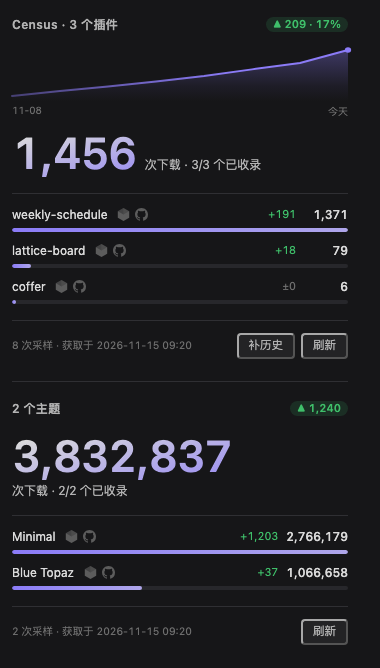

# Census



A curve for the plugins you track, a total for everything you track, and one row per target — in the status bar and in a right-sidebar tab.

## 它是什么

**盯住一组插件和主题，告诉你它们各自被下载了多少次、最近在怎么涨。**

- **右侧边栏面板**：插件块最上面是一条曲线（近 30 天），中间是合计的大字，下面每个插件一行 —— 名字、两个图标、30 天增量、当前数字、占比条
- **主题块只有数字，没有曲线**：官方对主题只给当前值，没有日级序列，画一条线就是替它编一个形状。所以主题块是合计 + 每行数量 + 占比条
- **两类分成两块**：各自的合计、各自的列表。只有两类都跟踪时才会出现第二块
- **每行两个图标**：Obsidian 的水晶打开商店页面（插件页或主题页），猫头打开 GitHub 仓库。还没上架社区目录的目标没有仓库，就只画水晶
- **状态栏**：只有一个目标时显示 `weekly-schedule · 1.4k`，多个时显示两类合计 `Census · 2.8M`
- **设置里分两组增删**：插件填 ID、主题填名字，回车即加，每行右侧一个 × 移除
- **三个命令**：`查看下载量`、`刷新下载量`、`在侧边栏打开读数`

## 数据从哪来

| 文件 | 用途 | 体积 | 多久读一次 |
|---|---|---|---|
| `community-plugin-stats.json` | 每个插件的累计下载量（`downloads` + `updated`） | 3.0 MB | 默认 12 小时 |
| `community-plugins.json` | 插件 ID → 仓库地址（为了 GitHub 图标） | 3.2 MB | 一周，或者新加了一个没查过的 ID |
| `releases.obsidian.md/stats/theme` | 每个主题的累计下载量（`download`，**没有时间戳**） | 80 KB | 默认 12 小时 |
| `community-css-themes.json` | 主题名 → 仓库地址、作者 | 181 KB | 一周，或者新加了一个没查过的名字 |

插件那两个文件在 `obsidianmd/obsidian-releases` 里，都是全量文件：**加十个和加一个是同一次请求**。统计文件只存跟踪的那几个数字，索引文件只存跟踪的那几个仓库，所以 `data.json` 一直是几行。

主题**没有**对应的统计文件 —— `community-css-themes-stats.json` 在 releases 仓库的历史里从来没存在过，数字只在一个实时接口后面（`?date=` 之类的参数会被忽略）。它反而便宜得多：80 KB 对 3 MB。索引里目前 1030 个主题，统计接口有 1613 个键，多出来的是下架后仍然留着数字的。

## 曲线从哪来

官方只给「现在」，不给历史 —— 插件那份是快照，主题那个接口更是只回答当下。所以插件的历史是自己的：

- **自动采样**：每次检查落在新的一天时记一个点。按 UTC 日分割，因为插件文件正是 UTC 00:1x 被机器人重写的。两类都跟踪时，同一天只记一个点，插件的数字和主题的数字并排写进去。
- **回填（仅插件）**：插件那个文件本身每天被提交一次，所以它自己的 git 历史就是一份日级日志。「回填最近 30 天」按天读过去 30 个提交，一天一个请求，只做一次。
- **主题不画曲线**：背后没有每天提交的文件，也没有日级序列。自己采样两天连成一条线，画出来的形状是插件那边的习惯，不是主题数据的样子 —— 所以主题块只给数字、占比条和近 30 天增量，横轴与曲线都不出现。
- **曲线按数据范围缩放，不从 0 开始**。30 天涨 4% 的插件对着零基线是一条直线，看不出任何东西；幅度交给右上角的百分比，斜率只回答「在涨还是在跌」。
- **采样不足两天就画虚线框**，写「还没有曲线」。一条平的假线比空框更会骗人。

## 几个刻意的决定

| 决定 | 为什么 |
|---|---|
| **一次请求覆盖全部** | 官方文件本来就是全量的，多跟踪一个不多花一个字节 |
| **插件和主题不混在一个列表/一条曲线里** | 两条管道的历史能力不一样：回填过的 29 天只有插件数字，主题接上的那天曲线会凭空跳起一两百万 —— 那是采样缺口，不是增长 |
| **主题不画曲线** | 官方没有主题的日级序列，画出来的斜率只反映我们自己什么时候开始采样，不反映主题本身。数字、占比条、近 30 天增量已经够回答「它现在多大、还在不在动」 |
| **主题名不做小写化** | 主题没有 ID，名字就是键，而且区分大小写：`Minimal` 有 276 万下载，`minimal` 是另一个只有 4 次的老条目。小写化会安静地读错主题 |
| **未收录显示 `—` 而不是 0** | 没上架和没人装是两件事，混在一起会骗人 |
| **未收录不会反复重拉** | 快照记下「问过哪些 ID」，否则每半小时都会为确认一件不会变的事重下几 MB |
| **刷新中的新增会排队** | 否则在请求飞行期间加的目标会被那次结果漏掉，而且再也不会补上 |
| **一天一个点** | 官方一天只更新一次；一天两个点会让「8 次采样」这句本身变成假话 |
| **回填要点一下才做** | 30 个几 MB 的请求不该背着用户发出去 |
| **缺仓库时不画灰猫** | 一个点了没反应的图标，比这里空一格更糟 |
| **两个图标都自己画** | 图标集里没有 Obsidian 品牌图标（`gem` 只是个菱形），而内置 GitHub 是描边的——一行里一个实心一个线框不像一对。两个都改用实心剪影、都吃 `currentColor`；水晶压暗两个背面做出棱线，否则 15px 下只是一块圆石头 |
| **主题页地址是算出来的** | 官网主题页的路径是「小写、只留字母数字、词间一个连字符」，对着全部 1030 个名字验过：`Rosé Pine → ros-pine`、`OLED.Black → oledblack`、`Dracula + LYT → dracula-lyt` |
| **榜单按下载量排** | 未收录的行沉到最后，否则半屏的 `—` 看起来像坏了（设置里仍是你添加的顺序） |
| **多个目标时状态栏显示合计** | 单个目标的数字放不进状态栏，明细由 tooltip 和面板负责 |

## 这个数字意味着什么

`downloads` 统计的是**安装 + 每次更新**的累计次数，不是用户数。一个发版频繁的插件，同一个用户会反复计数。跨目标比较时要记得这一点：周更的插件天然比年更的高。主题也一样，只是主题的更新通常少一些。

另外插件的 `updated` 是官方重算该条目的时间，可能比文件本身晚一天左右，而且每个插件各不相同 —— 所以面板只在只有一个插件时，把它放进页脚那行的 tooltip 里。主题的接口没有这个字段，主题块的页脚也就不提供它。

## 开发

```bash
npm install
npm run dev      # esbuild watch
npm test         # 纯函数单测（node --test，不依赖 Obsidian）
npm run build    # tsc 类型检查 + 生产构建
npm run deploy -- ./dev-vault
```

`src/stats.ts` 负责读两类统计文件（同一个解析器读 `downloads` 和 `download` 两种拼法），`src/history.ts` 负责采样、窗口、涨跌、曲线坐标与旧 key 迁移，`src/registry.ts` 负责从两个目录索引里取仓库地址、算主题页地址。三个都**不 import `obsidian`**，所以解析与算术全部能在 Node 里跑测试。`src/main.ts` 只负责生命周期、状态栏、两个数据源各自的取数与合并，`src/view.ts` 是那块面板。

## 隐私

只对公开文件发匿名 GET：

- 每 12 小时一次插件统计文件（3.0 MB）
- 每 12 小时一次主题统计接口（80 KB），只在跟踪了主题时
- 每周一次目录索引（3.2 MB / 181 KB），只在需要链接时
- 点「回填」时，一次性约 30 个请求（只有插件）

不发送任何关于仓库、笔记或你的信息，无遥测。

## License

MIT
